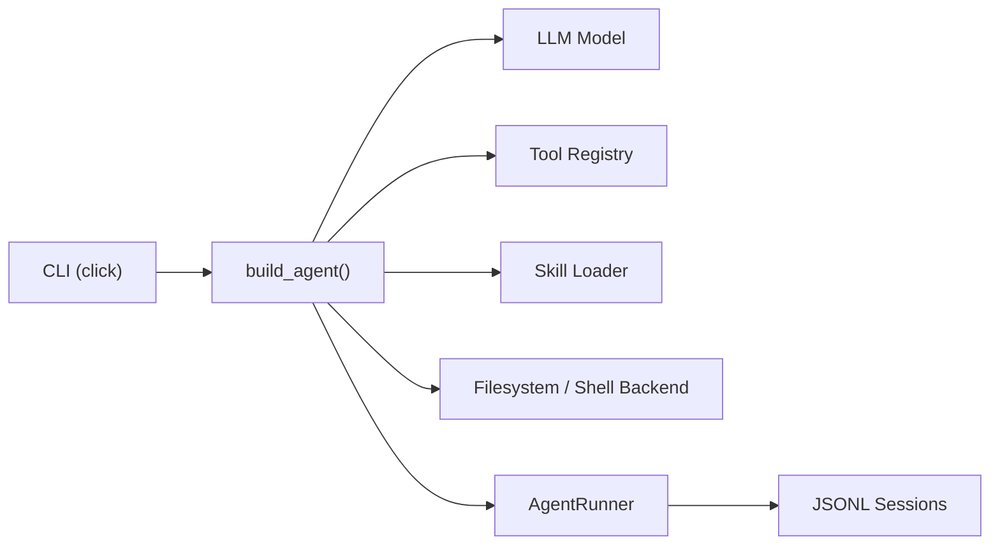

# Architecture Diagram

How to create clear, accurate architecture diagrams using Mermaid.

## Diagram types

| Use case | Mermaid type |
|---|---|
| Component relationships | `graph LR` |
| Data flow | `graph TD` |
| Sequence / API call | `sequenceDiagram` |
| State machine | `stateDiagram-v2` |
| Entity-relation | `erDiagram` |

## Component diagram template

## Quality checklist

- [ ] Every box is a real component in the codebase
- [ ] Every arrow has a direction and represents a real call/data flow
- [ ] Diagram fits on one screen (≤12 nodes)
- [ ] Title and brief description accompany the diagram
